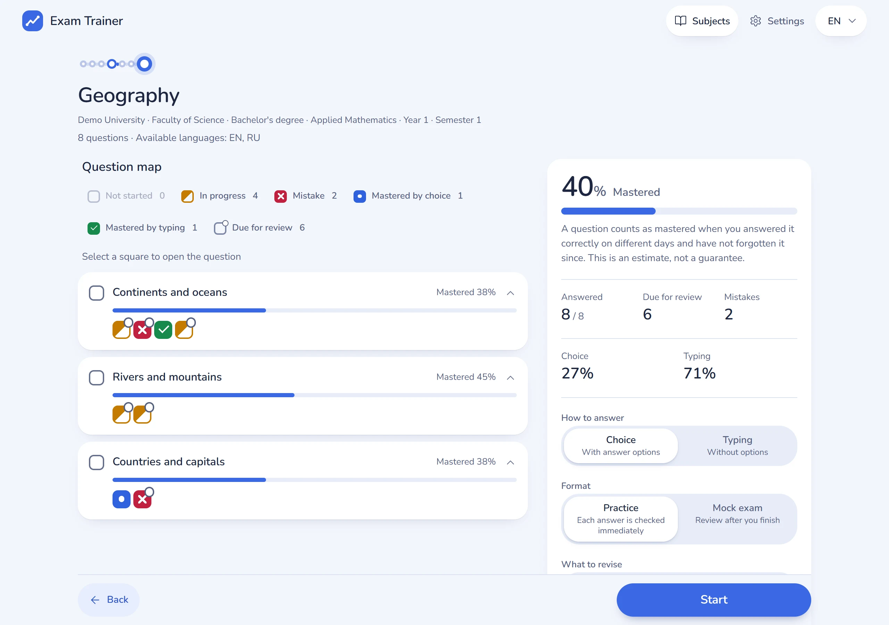
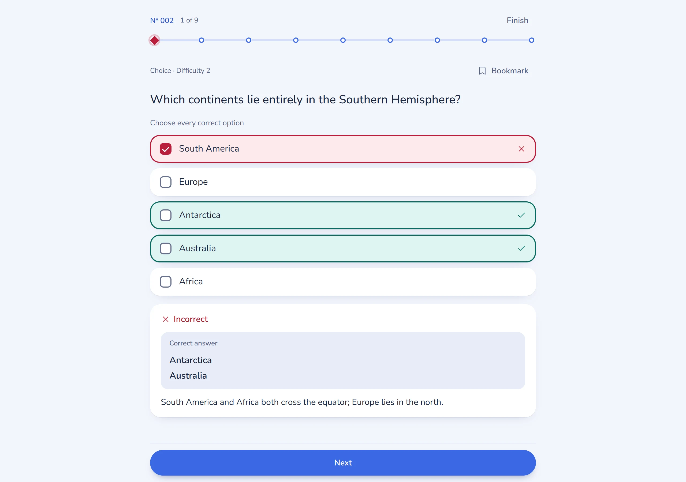
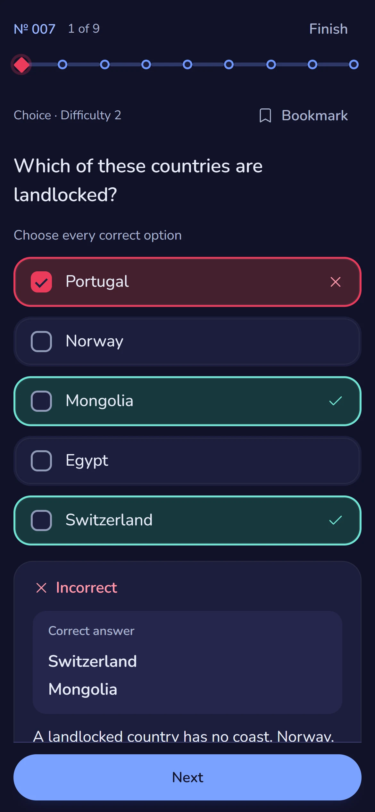

[Қазақша](README.kk.md) · [Русский](README.md) · [English](README.en.md)

<p align="center">
  
</p>

<h1 align="center">Exam Trainer</h1>

<p align="center">
  Exam preparation with test question banks: practice with an explanation after every answer, mistake review and a timed mock exam.
</p>

<p align="center">
  <a href="https://github.com/SSSox/exam-platform/releases/latest/download/exam-trainer-windows-setup.exe"><b>Download for Windows</b></a>
  &nbsp;·&nbsp;
  <a href="https://github.com/SSSox/exam-platform/releases/latest/download/exam-trainer-android.apk"><b>Download for Android</b></a>
  &nbsp;·&nbsp;
  <a href="https://sssox.github.io/exam-platform/"><b>Web version</b></a>
  &nbsp;·&nbsp;
  <a href="https://github.com/SSSox/exam-platform/releases">All versions</a>
</p>

<picture>
  <source media="(prefers-color-scheme: dark)" srcset="docs/screenshots/en/bank-dark.webp">
  
</picture>

An app for preparing for exams with test question banks. A student picks a semester, opens a subject and practises: answers questions, sees the explanation straight away, and returns to the mistakes. Before the exam there is a mock test with a timer.

The code is not tied to any university or subject. The tree of sections and the questions live in plain JSON files in a separate bank repository. To add a subject or a whole university, you change the data. The address of the bank repository is set in `content-sources.json`: the app fetches the banks from it over the network, so editing the banks does not require rebuilding the app. The built-in snapshot stays as a fallback source. There are Windows and Android versions (Tauri) and a web version (a static build that suits GitHub Pages).

This is the code repository. It contains no real banks, only a small demo set in `examples/demo-content`.

## Screenshots

Right after an answer the app shows the review: what you picked, the correct answer and the explanation from the bank.



The phone gets the same screens. Frequent buttons sit in the bottom bar, within reach of the thumb. On the right is the dark theme.

<p align="center">
  
  &nbsp;&nbsp;
  
</p>

The screenshots use the demo banks from `examples/demo-content`.

## Installation

Without installing anything, the app opens in the browser: [web version](https://sssox.github.io/exam-platform/). It keeps answers and progress in that browser.

Windows 10 and 11, 64-bit. Download the [installer](https://github.com/SSSox/exam-platform/releases/latest/download/exam-trainer-windows-setup.exe) and run it. Until the installer carries a publisher signature, SmartScreen may show a "Windows protected your PC" window. To go on, click "More info", then "Run anyway". The [Code signing policy](#code-signing-policy) section explains why there is no signature yet.

Android 7.0 or newer, on a phone with a 64-bit processor (ARM64). Download the [APK](https://github.com/SSSox/exam-platform/releases/latest/download/exam-trainer-android.apk) on the phone and open it. Android asks to allow installing apps from unknown sources: on Android 8 and newer the permission goes to the browser or file manager that opened the file. Allow it and go back to the installation.

Both apps check once a day for a new version. The "Update" button in the settings downloads it, and answers and progress stay. On Android 8 and newer, the app asks for permission to install updates before the first one.

## What the app does

- A catalog built as a tree of any depth: university, faculty, degree, specialty, year of study, academic year, semester, subject. A student chooses their semester once. The app remembers the choice on the device and opens it right at launch. Along the way it skips folders with a single entry until the tree reaches a choice of two or more. You change the choice with the "Change" button or forget it in the settings ("Forget the starting section"); answers and progress stay. The "Delete all data" button on the same screen erases answers, settings and downloaded banks from the device after a confirmation.
- A subject can be a group of banks, for example with levels inside.
- Two answer modes: choosing an option and typing on the keyboard. Questions that cannot be answered by typing become self-check (show the answer and mark whether you knew it) or are skipped, depending on the settings.
- Practice with an explanation after every answer, and a mock exam with a timer. In the exam you can jump to any question by its number. The exam review appears when the exam ends. The pass mark is 50%. An exam in progress survives a page reload or a closed app: the next launch opens it on the same question with the same answers, and the clock has kept running.
- Questions can be selected by topic, difficulty level and number. You can also repeat only the mistakes or only the bookmarks. "Smart mix" takes mistakes and questions that are due for review first, then new ones, and brings back the questions the student gets wrong more often.
- One correct answer does not clear a mistake. In practice, a question the student missed comes back in the same sitting after three questions; if the repeat is correct, once more after six. This goes on until the student answers it correctly twice in a row, with at most four returns of one question per sitting. The same question never appears twice in a row.
- Spaced repetition between sittings: a correct answer pushes the question out by 8 hours, then 2, 5, 12 and 30 days, and a mistake sends it back to the start. Answering early does not move the question up. The 30-day wait is reached only by typed or self-checked answers; with answer options the longest wait is 12 days.
- Mastery statistics: a question counts as mastered when the student answered it correctly on different days and has not forgotten it since. The mastery percentage is shown for each topic and for the whole bank: the further a question has moved through the intervals, the more it counts, and an overdue review lowers its weight. It is an estimate, not a guarantee.
- Question types: one or several options, short text, a number with a tolerance, an extended answer with criteria. Markdown and KaTeX formulas work in question text.
- When the app checks a typed answer, it ignores letter case, punctuation, grammatical case endings, Latin look-alike letters inside a Russian word, and one or two typos in long words. It does not accept a different term from the same bank. If the app gets it wrong, you can dispute the answer.
- A question map by topic. Every question on it is a square you can select: a window opens with the question text, the answer history, the buttons "Answer it", "Show the answer" and "Bookmark", and arrows to the neighbouring questions. Five states (not started, in progress, mistake, mastered by choice, mastered by typing) differ in colour and in shape, and a "due for review" mark sits on any of them. The legend rows work as filters. Next to the map are statistics by mode, bookmarks and a list of mistakes. The progress log can be exported to a file and loaded back, so it can be moved to another device.
- The interface is in three languages: kk, ru, en. The question language is chosen separately: if there is no translation, the question is shown in its original language. The theme is system, light or dark.
- Works offline: files that have been read are cached, and a copy of the content is stored inside the app.
- The web version points to the apps: links to the Windows and Android installers sit under the subject list and in the settings. The apps themselves do not show these links.
- The Windows and Android apps update from GitHub releases: once a day they check whether a new version is out, and when you press "Update" they download it, check the signature and install it over the old one. Answers and settings are kept.

## How it works

Two repositories with different jobs:

| Repository | What it contains | Who changes it |
| --- | --- | --- |
| Code (this one) | the app, the format schema, answer checking, a command-line tool for working with content | the developer |
| Banks (for example, `exam-content`) | a folder tree with `node.json`, `bank.json` banks, questions, translations | content editors |

Banks are published separately. The `compile` command turns the folder tree into a set of files whose names contain a hash of their content (`index.json`, `nodes/<hash>.json`, `banks/<hash>.json`). You put this set on any static hosting, for example GitHub Pages. The app reads `index.json`, downloads only the files that changed, checks the hash of each one and caches them for good.

Where the app gets the banks:

1. `index.json` is downloaded from the network addresses in `content-sources.json`, one after another (`VITE_CONTENT_URLS`, comma-separated, replaces them for one build). An address that does not answer within 6 seconds is skipped.
2. Without a network the app uses the last saved `index.json`, and on the very first start the built-in snapshot `./content`, if the build has one. Either way it says there is no network.
3. A bank file is looked up in the cache first, then in the built-in snapshot, and only then on the network, so a bank shipped with the app opens without a request. Files the fresh `index.json` no longer refers to are removed from the cache.

All the logic in `packages/core` is independent of the shell: the interface and Tauri only display it. Progress is stored as an event log that is only ever appended to, and logs from two devices merge without conflicts.

## Requirements

- Node.js 26 (the version it was tested on). Scripts run as `.ts` files with no separate build step.
- npm. The project uses npm workspaces.
- The Windows installer needs Rust and the system dependencies of Tauri 2 (see the Tauri documentation).
- Android needs Rust with the `aarch64-linux-android` target (plus `x86_64-linux-android` for an emulator), JDK 21 (not newer), the Android SDK with platform 37, and NDK 28. The paths go into the `JAVA_HOME`, `ANDROID_HOME` and `NDK_HOME` variables.

## Quick start

```bash
npm install
npm --prefix apps/ui run dev
```

The interface opens at `http://localhost:5183`. Before it starts, the script `apps/ui/scripts/content.mjs` assembles the content into `apps/ui/public/content`. The source is chosen like this:

1. The folder from the `EXAM_CONTENT_DIR` variable, if it is set. The value `none` embeds nothing, and the app takes banks only over the network.
2. The `exam-content` folder next to this repository, if it contains `catalog.json`.
3. `examples/demo-content` from this repository.

If there is no `exam-content` folder next to it and the variable is not set, you will see the demo content: five small banks of two specialties of "Demo University".

Variables are set before the command. In bash:

```bash
EXAM_CONTENT_DIR=/path/to/banks npm --prefix apps/ui run dev
```

In PowerShell:

```powershell
$env:EXAM_CONTENT_DIR = "C:\path\to\banks"; npm --prefix apps/ui run dev
```

A relative path is resolved from the folder where npm was started, so an absolute path is safer.

## Connecting a bank repository

The app takes banks from a repository published as a static site. The site address is passed at build time:

```bash
EXAM_CONTENT_DIR=none VITE_CONTENT_URLS=https://<user>.github.io/<bank-repository> npm --prefix apps/ui run build
```

Here `EXAM_CONTENT_DIR=none` removes the built-in snapshot, and `VITE_CONTENT_URLS` says where to download from. You can list several addresses separated by commas: the app tries them in turn. A build like this has no snapshot, so without a network it shows only what it has already downloaded. You can also save the variable in `apps/ui/.env.local` (it is not committed to git):

```
VITE_CONTENT_URLS=https://<user>.github.io/<bank-repository>
```

The address in the example is a placeholder: use the address of your own bank repository. In PowerShell, variables are set through `$env:`, as in the example above. The app page loads content only from `https://*.github.io` and `https://cdn.jsdelivr.net`. If the banks are on another host, add it to `connect-src` in `apps/ui/index.html`.

Step-by-step publishing of the app and the banks, with workflow templates for GitHub Actions: [docs/PUBLISHING.en.md](docs/PUBLISHING.en.md).

## Build

The static build of the interface ends up in `apps/ui/dist`:

```bash
npm --prefix apps/ui run build
```

Paths in the build are relative, so it works on web hosting, in a subfolder and inside Tauri.

The Windows installer (NSIS). The build takes a long time:

```bash
cd apps/desktop
npx tauri build
```

The Android APK (the `JAVA_HOME`, `ANDROID_HOME` and `NDK_HOME` variables from the Requirements section must be set). Phones need only the `aarch64` target, which gives an APK of about 9 MB. For an x86_64 emulator, add `--target x86_64`.

```bash
cd apps/desktop
npx tauri android build --apk --target aarch64
```

The release APK is signed with the key named in `src-tauri/gen/android/keystore.properties`. Git ignores this file; a sample sits next to it as `keystore.properties.example`. Copy it and fill in the full path to the key file (`.jks` or `.keystore`, written with `/` and without `~`) and the key alias. The passwords can go in the same file, or into the `KEYSTORE_PASSWORD` and `KEY_PASSWORD` environment variables for the length of the build. The signed file is `src-tauri/gen/android/app/build/outputs/apk/universal/release/app-universal-release.apk`. Without `keystore.properties` the build leaves the APK unsigned (`app-universal-release-unsigned.apk`), and a phone will not install it.

If you have no key yet, `keytool` from the JDK creates one:

```bash
keytool -genkeypair -keystore "$HOME/exam-trainer-release.jks" -alias exam-trainer -keyalg RSA -keysize 4096 -validity 10000
```

Keep the key and its passwords outside the repository, and back them up. A new version installs over the old one only when it is signed with the same key. After a key change the app has to be uninstalled, and the progress goes with it: it lives only on the phone, and only a progress file can carry it over. When you install the file by hand, the phone asks you to allow installs from that source. On Android, progress is saved and loaded through the system file dialog.

The desktop app window in development mode: `npx tauri dev` from the same folder. The Tauri build runs the interface build, so the `EXAM_CONTENT_DIR` and `VITE_CONTENT_URLS` variables affect it too.

The web version takes the installer link addresses from `downloads.json` at build time (fields `windows` and `android`). `VITE_DOWNLOAD_WINDOWS` and `VITE_DOWNLOAD_ANDROID` replace them for one build, the value `none` removes a link, and an address that does not start with `https://` stops the build. By default the links point to the files of the latest GitHub release of the code repository; how to publish one is described in [docs/PUBLISHING.en.md](docs/PUBLISHING.en.md).

To make the apps update themselves, the public update key goes into `plugins.updater.pubkey` in `tauri.conf.json`, and a release is prepared by the `npm run release` command: it signs the installer and the APK and writes `latest.json`. The key and the release steps are described in [docs/PUBLISHING.en.md](docs/PUBLISHING.en.md).

## Working with content

The command-line tool is in `packages/content-tools`:

```bash
node packages/content-tools/src/cli.ts <command> ...
```

There is a shortcut in the repository root: `npm run content -- <command> ...`.

| Command | What it does |
| --- | --- |
| `validate <content-dir>` | checks the folder layout, schemas, duplicate identifiers, keys and free-input blocks |
| `compile <content-dir> <target>` | builds the files with hashes in their names for the app |
| `merge-translations <content-dir>` | merges the translations from `translations/` into the banks |
| `schema <target>` | writes the JSON Schema of the format |
| `migrate <v1.json> <bank-id> <bank-dir>` | converts a bank in format 1.0 to `exambank/2` |
| `verify <v1.json> <bank-dir>` | builds the bank back into format 1.0 and compares it with the source file |

Validate the demo content:

```bash
npm run content -- validate examples/demo-content
```

The command prints the number of banks and questions. The format, the folder layout, and the rules for identifiers and translations are described in [docs/FORMAT.en.md](docs/FORMAT.en.md).

- The bank identifier (`id` in `bank.json`) never changes: students' progress refers to it. A bank can be renamed and moved between folders as long as `id` stays the same.
- A question identifier does not change and is not reused. A question that is no longer needed is marked `"retired": true`.
- Translations go in `<bank>/translations/<locale>/` and are merged with the `merge-translations` command. The bank's own language is never edited through translations.

## Repository structure

```
packages/
  schema/             Zod schemas of the format
  core/               answer checking, sessions, progress, memory and question picking, content client, tree traversal
  content-tools/      command line and the validate, compile, merge, migrate functions
apps/
  ui/                 interface: React 19, Vite
  desktop/            Windows and Android shell: Tauri 2
examples/
  demo-content/       neutral demo bank repository
.github/workflows/
  pages.yml           publish the web version to GitHub Pages
  release.yml         build and sign the Windows installer in GitHub Actions
.signpath/            signing settings for SignPath
docs/
  FORMAT.md           the exambank/2 format and folder layout
  PUBLISHING.md       publishing to GitHub Pages and making releases
  screenshots/        README screenshots, taken on the demo banks
content-sources.json  addresses of the bank site
downloads.json        installer links of the web version
```

## Checks

```bash
npx vitest run     # tests: schema, answer checking, sessions, progress, spaced repetition and picking, content, translations, tree traversal
npx tsc -p .       # types: packages and interface
```

The tests use `examples/demo-content` and write only to temporary folders. The interface has no automated tests, so after changes you check it by hand in a browser.

## Technologies

TypeScript, Zod 4, React 19, Vite 7, Dexie (IndexedDB), i18next, markdown-it with DOMPurify, KaTeX, Tauri 2, Vitest.

## Code signing policy

The Windows installer is not signed with a publisher certificate yet, and SmartScreen may warn about an unknown publisher. The project is applying for free signing through [SignPath Foundation](https://signpath.org).

Only files that GitHub Actions builds from this repository ([`release.yml`](.github/workflows/release.yml)) will be signed: the `exam-desktop.exe` app and the installer. The uninstaller that NSIS creates gets no separate signature. The Android APK is signed with the developer's key, not through SignPath.

- Authors and change review: [SSSox](https://github.com/SSSox).
- Approval of each signature: [SSSox](https://github.com/SSSox).
- Privacy: the app does not send any information about the user. Over the network it only downloads question banks from GitHub Pages (addresses from `content-sources.json`) and checks for updates in GitHub releases. Answers, progress and settings stay on the device. These requests are covered by the [GitHub privacy policy](https://docs.github.com/site-policy/privacy-policies/github-general-privacy-statement).

## License

Copyright (C) 2026 SSSox

Exam Trainer is licensed under the GNU General Public License, version 3 or (at your option) any later version (GPL-3.0-or-later). The full text is in [LICENSE](LICENSE). The program comes with no warranty.
