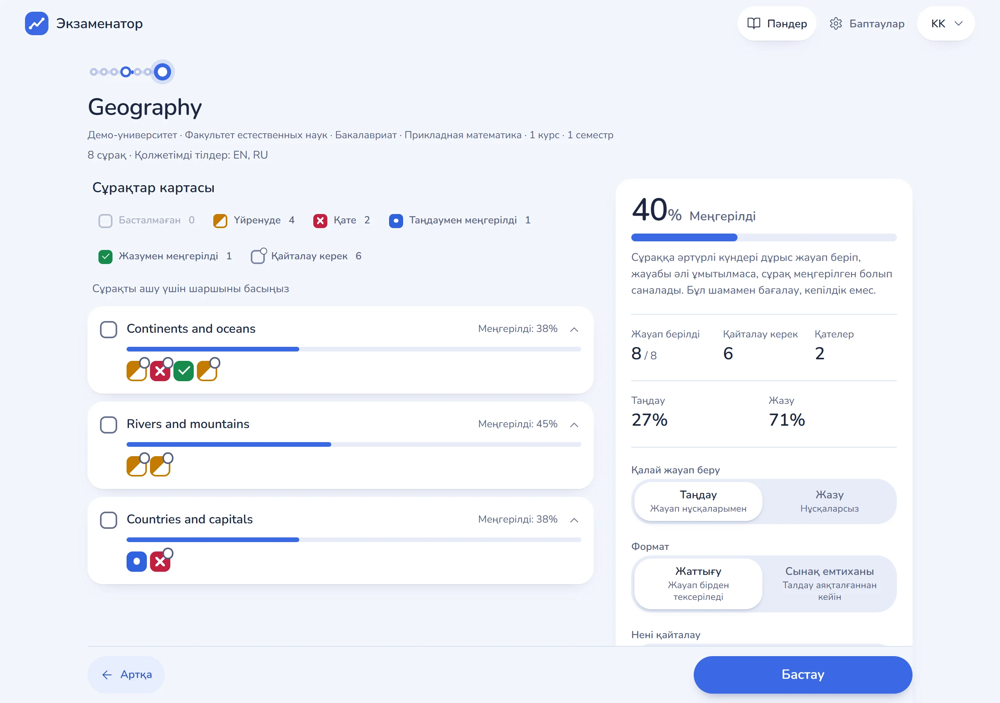
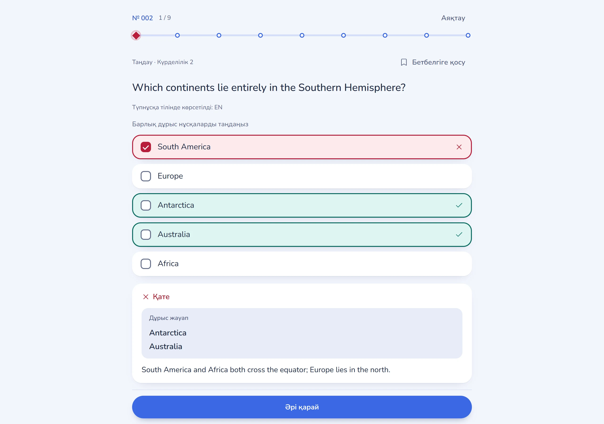
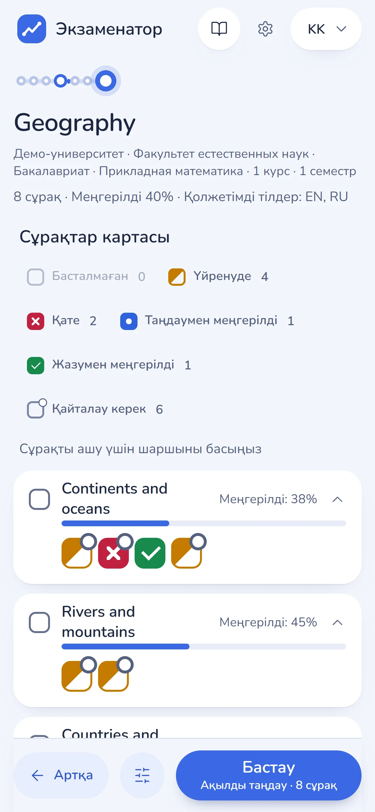
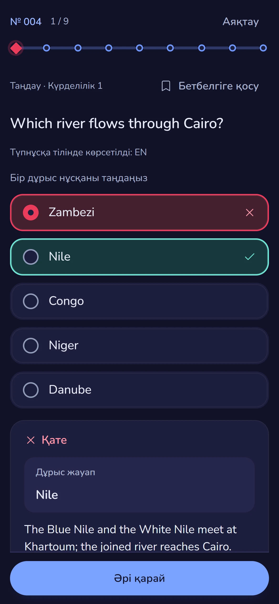

[Қазақша](README.kk.md) · [Русский](README.md) · [English](README.en.md)

<p align="center">
  
</p>

<h1 align="center">Экзаменатор</h1>

<p align="center">
  Тест сұрақтарының банктері бойынша емтиханға дайындық: әр жауаптан кейін талдауы бар жаттығу, қателерді қайталау және таймері бар сынақ емтиханы.
</p>

<p align="center">
  <a href="https://github.com/SSSox/exam-platform/releases/latest/download/exam-trainer-windows-setup.exe"><b>Windows үшін жүктеу</b></a>
  &nbsp;·&nbsp;
  <a href="https://github.com/SSSox/exam-platform/releases/latest/download/exam-trainer-android.apk"><b>Android үшін жүктеу</b></a>
  &nbsp;·&nbsp;
  <a href="https://sssox.github.io/exam-platform/"><b>Веб-нұсқа</b></a>
  &nbsp;·&nbsp;
  <a href="https://github.com/SSSox/exam-platform/releases">Барлық нұсқалар</a>
</p>

<picture>
  <source media="(prefers-color-scheme: dark)" srcset="docs/screenshots/kk/bank-dark.webp">
  
</picture>

Емтиханға тест сұрақтарының банктері бойынша дайындалуға арналған қолданба. Студент өз семестрін таңдайды, пәнді ашады да жаттығады: сұрақтарға жауап береді, талдауды бірден көреді, қателеріне қайта оралады. Емтихан алдында таймері бар сынақ тестін өтуге болады.

Код жоғары оқу орындары мен пәндерге байланбаған. Бөлімдер ағашы мен сұрақтар жеке банктер репозиторийіндегі қарапайым JSON файлдарында сақталады. Пән немесе тұтас университет қосу үшін деректерді өзгерту жеткілікті. Банктер репозиторийінің мекенжайы `content-sources.json` файлында жазылған: қолданба банктерді осы мекенжай бойынша желі арқылы тартады, сондықтан банктерді түзеткенде қолданбаны қайта құрастырудың қажеті жоқ. Кірістірілген көшірме қосалқы көз ретінде қалады. Windows және Android нұсқалары (Tauri) мен веб-нұсқа (GitHub Pages-ке жарайтын статикалық құрастырма) жұмыс істейді.

Бұл код репозиторийі. Онда нақты банктер жоқ, тек `examples/demo-content` ішінде шағын демо-жинақ бар.

## Скриншоттар

Жауап берген соң қолданба бірден талдауды көрсетеді: сіз не таңдадыңыз, дұрыс жауап қайсы және банктегі түсініктеме.



Телефонда да сол экрандар. Жиі басылатын түймелер төменгі панельде, бас бармақ жететін жерде тұр. Оң жақта қараңғы көрініс.

<p align="center">
  
  &nbsp;&nbsp;
  
</p>

Скриншоттар `examples/demo-content` демо-банктерінде түсірілген. Демо-банктерде қазақша аударма жоқ, сондықтан сұрақтар мен атаулар ағылшын немесе орыс тілінде көрсетіледі.

## Орнату

Қолданбаны орнатпай-ақ браузерде ашуға болады: [веб-нұсқа](https://sssox.github.io/exam-platform/). Жауаптар мен үлгерім сол браузерде сақталады. Бірінші рет ашқаннан кейін бет интернетсіз де іске қосылады, бұрын ашылған банктермен бірге; браузер мәзірі арқылы оны қолданба ретінде орнатуға болады.

Windows 10 және 11, 64 биттік. [Орнатқышты](https://github.com/SSSox/exam-platform/releases/latest/download/exam-trainer-windows-setup.exe) жүктеп, іске қосыңыз. Орнатқышта әзірге жариялаушының қолтаңбасы жоқ, сондықтан SmartScreen «Система Windows защитила ваш компьютер» (Windows protected your PC) терезесін көрсетуі мүмкін. Жалғастыру үшін «Подробнее» (More info), содан кейін «Выполнить в любом случае» (Run anyway) түймесін басыңыз. Қолтаңбаның неге әлі жоқ екені [Кодқа қол қою саясаты](#кодқа-қол-қою-саясаты-code-signing-policy) бөлімінде жазылған.

Android 7.0 және одан жаңасы, 64 биттік процессоры бар телефон (ARM64). [APK файлын](https://github.com/SSSox/exam-platform/releases/latest/download/exam-trainer-android.apk) телефонға жүктеп, ашыңыз. Android белгісіз көздерден қолданба орнатуға рұқсат сұрайды: Android 8 және одан жаңасында бұл рұқсат файлды ашқан браузерге немесе файл менеджеріне беріледі. Рұқсат беріп, орнатуға қайта оралыңыз.

Екі қолданба да күніне бір рет жаңа нұсқаның шыққанын тексереді. Жаңартуды баптаулардағы «Жаңарту» түймесі жүктейді, жауаптар мен үлгерім сақталады. Android 8 және одан жаңасында бірінші жаңарту алдында қолданба жаңартуларды орнатуға рұқсат сұрайды.

## Қолданба не істей алады

- Тереңдігі кез келген ағаш түріндегі каталог: университет, факультет, дәреже, мамандық, курс, оқу жылы, семестр, пән. Студент өз семестрін бір-ақ рет таңдайды, қолданба таңдауды құрылғыда есте сақтап, іске қосқанда бірден ашады. Тек бір жазбасы бар қалталарды қолданба екі немесе одан көп нұсқа кездескенше өткізіп жібереді. Таңдауды «Ауыстыру» түймесімен өзгертуге немесе баптауларда («Бастапқы бөлімді ұмыту») ұмытуға болады: жауаптар мен үлгерім сақталады. Сол жердегі «Барлық деректерді жою» түймесі растаудан кейін жауаптарды, баптауларды және жүктелген банктерді құрылғыдан өшіреді.
- Пән банктер тобы болуы мүмкін, мысалы, ішінде деңгейлері бар.
- Жауап берудің екі режимі: нұсқаны таңдау және пернетақтадан енгізу. Енгізіп жауап беруге болмайтын сұрақтарды қолданба баптаудағы таңдауға қарай өзін-өзі тексеру (жауапты көрсетіп, білгеніңді не білмегеніңді белгілеу) түрінде ұсынады немесе өткізіп жібереді.
- Әр жауаптан кейін талдауы бар жаттығу және таймері бар сынақ емтиханы. Емтиханда кез келген сұраққа нөмірі арқылы өтуге болады. Емтихан талдауы емтихан аяқталған соң шығады, өту шегі 50 %. Басталған емтихан бетті қайта жүктегенде немесе қолданбаны жапқанда жоғалмайды: келесі іске қосқанда сол сұрақта, сол жауаптармен ашылады, ал уақыт сағат бойынша жүре береді.
- Сұрақтарды тақырып, күрделілік деңгейі және саны бойынша іріктеуге болады. Тек қателерді немесе тек бетбелгілерді бөлек қайталауға да болады. «Ақылды таңдау» алдымен қателерді және қайталау мерзімі келген сұрақтарды, содан кейін жаңаларын алады, ал студент жиірек қателесетін сұрақтарды жиірек қайтарады.
- Қолданба дайындық баптауын әр банк үшін есте сақтайды. Банкте нақты емтиханның ұзақтығы мен сұрақ саны көрсетілсе, сынақ емтиханы оларды бір түймемен қояды, ал тестке әр қиындық деңгейінен қанша сұрақ кіретіні де көрсетілсе, сұрақтарды сол үлестерде алады. Нәтиже экранынан сол тәсілді қайта бастауға немесе тек қате кеткен сұрақтарды өтуге болады, ал талдауда сіздің жауабыңыз, дұрыс жауап және түсіндірме көрсетіледі. Бұрынғы сынақ емтихандары банк шолуында тұрады. Картада сұрақ мәтіні бойынша іздеу бар, каталогта пәннің жанында қанша сұрақты қайталау керегі көрінеді. Пернетақтада цифр нұсқаны таңдайды, Enter негізгі түймені басады. Веб-нұсқа жауаптар файлға көптен сақталмаса, соны еске салады.
- Бір дұрыс жауап қатені өшірмейді. Жаттығуда студент қателескен сұрақ сол сеанста үш сұрақтан кейін қайта келеді; қайталау дұрыс болса, тағы алты сұрақтан кейін келеді. Студент қатарынан екі рет дұрыс жауап бермейінше осылай жалғасады, бірақ бір сұрақ сеансқа төрт реттен артық қайтарылмайды. Бір сұрақ қатарынан екі рет келмейді.
- Сеанстар арасындағы аралықпен қайталау: дұрыс жауап сұрақты 8 сағатқа, содан кейін 2, 5, 12 және 30 күнге ысырады, ал қате оны басына қайтарады. Мерзімінен ертерек берілген жауап сұрақты жоғарылатпайды. 30 күндік аралыққа тек енгізіп немесе өзін-өзі тексеріп берілген жауаптар жетеді, нұсқаны таңдағанда ең ұзақ аралық 12 күн.
- Меңгеру статистикасы: студент сұраққа әр түрлі күндері дұрыс жауап беріп, оны ұмытпаса, сұрақ меңгерілген болып саналады. Меңгеру пайызы әр тақырып бойынша және бүкіл банк бойынша көрсетіледі: сұрақ аралықтар бойынша неғұрлым алысқа барса, соғұрлым көп ұпай береді, ал мерзімі өткен қайталау оның салмағын азайтады. Бұл бағалау, кепілдік емес.
- Сұрақ түрлері: бір немесе бірнеше нұсқа, қысқа мәтін, рұқсат етілген ауытқуы бар сан, өлшемдері бар толық жауап. Сұрақ тұжырымдарында Markdown және KaTeX формулалары жұмыс істейді.
- Енгізілген жауапты тексеру әріп регистрін, тыныс белгілерін, септік жалғауларын, орыс сөзіндегі кириллицаға ұқсас латын әріптерін және ұзын сөздердегі бір-екі әріп қателігін ескермейді. Сол банктегі басқа терминді қолданба дұрыс деп санамайды. Қолданба қателессе, жауапқа дау айтуға болады.
- Тақырыптар бойынша сұрақтар картасы. Картадағы әр сұрақ басуға болатын шаршы: сұрақ мәтіні, жауап тарихы, «Жауап беру», «Жауапты көрсету» және «Бетбелгіге қосу» түймелері және көрші сұрақтарға өтетін көрсеткілері бар терезе ашылады. Бес күй (басталмаған, үйренуде, қате, таңдаумен меңгерілді, жазумен меңгерілді) түсі мен пішіні бойынша ерекшеленеді, ал «қайталау керек» белгісі кез келгенінде тұра алады. Шартты белгілер қатарлары сүзгі болып жұмыс істейді. Картаның жанында режимдер бойынша статистика, бетбелгілер және қателер тізімі бар. Үлгерім журналы файлға сақталып, кері жүктеледі, сондықтан оны басқа құрылғыға көшіруге болады.
- Интерфейс үш тілде: kk, ru, en. Сұрақ тілі бөлек таңдалады: аударма болмаса, сұрақ түпнұсқа тілінде көрсетіледі. Көрініс: жүйелік, ашық немесе қараңғы.
- Желісіз жұмыс істейді: оқылған мазмұн файлдары кэште сақталады, ал мазмұнның көшірмесі қолданбаның ішінде жатады.
- Веб-нұсқа қолданбаларға апарады: пәндер тізімінің астында және баптауларда Windows мен Android орнатқыштарына сілтемелер бар. Қолданбалардың өзінде бұл сілтемелер жоқ.
- Windows және Android қолданбалары GitHub релиздерінен жаңарады: күніне бір рет жаңа нұсқаның шыққанын тексереді, ал «Жаңарту» түймесін басқанда оны жүктеп, қолтаңбаны тексеріп, ескісінің үстіне орнатады. Жауаптар мен баптаулар сақталады. Сайттың жаңа нұсқасы шыққанда веб-нұсқа «Жаңарту» түймесі бар жолды көрсетеді және тек сол түймемен ауысады.

## Бұл қалай құрылған

Міндеттері әртүрлі екі репозиторий:

| Репозиторий | Онда не бар | Кім өзгертеді |
| --- | --- | --- |
| Код (осы) | қолданба, формат схемасы, жауапты тексеру, мазмұнмен жұмыс істеуге арналған пәрмен жолы | әзірлеуші |
| Банктер (мысалы, `exam-content`) | `node.json` бар қалталар ағашы, `bank.json` банктері, сұрақтар, аудармалар | мазмұн редакторлары |

Банктер бөлек жарияланады. `compile` пәрмені қалталар ағашын аттарында мазмұнының хэші бар файлдар жиынына айналдырады (`index.json`, `nodes/<хэш>.json`, `banks/<хэш>.json`). Бұл жиынды кез келген статикалық хостингке, мысалы, GitHub Pages-ке орналастырады. Қолданба `index.json` файлын оқиды, тек өзгерген файлдарды жүктейді, әр файлдың хэшін тексереді және оларды біржола кэште сақтайды.

Қолданба банктерді қайдан алады:

1. `index.json` файлы `content-sources.json` ішіндегі желі мекенжайларынан кезекпен жүктеледі (`VITE_CONTENT_URLS` үтірмен бөлініп, бір құрастыруға оларды алмастырады). 6 секунд ішінде жауап бермеген мекенжай өткізіліп жіберіледі.
2. Желі болмаса, соңғы сақталған `index.json` алынады, ал ең алғашқы іске қосуда кірістірілген көшірме `./content` (егер құрастырмада бар болса). Екі жағдайда да қолданба желі жоқ екенін жазады.
3. Банк файлы алдымен кэштен, содан кейін кірістірілген көшірмеден, тек содан соң желіден ізделеді, сондықтан қолданбамен бірге келген банк сұраусыз ашылады. Жаңа `index.json` енді сілтемейтін файлдар кэштен жойылады.

`packages/core` ішіндегі бүкіл логика қабықшаға тәуелсіз: интерфейс пен Tauri оны тек көрсетеді. Үлгерім тек толықтырылатын оқиғалар журналы ретінде сақталады, ал екі құрылғының журналдары қайшылықсыз қосылады.

## Талаптар

- Node.js 26 (осы нұсқада тексерілген). Скрипттер бөлек құрастырусыз `.ts` ретінде іске қосылады.
- npm. Жоба npm workspaces пайдаланады.
- Windows орнатқышы үшін Rust және Tauri 2-нің жүйелік тәуелділіктері қажет (Tauri құжаттамасын қараңыз).
- Android үшін `aarch64-linux-android` мақсаты бар Rust (эмулятор үшін `x86_64-linux-android` те), JDK 21 (одан жаңасы жарамайды), 37-платформасы бар Android SDK және NDK 28 қажет. Жолдар `JAVA_HOME`, `ANDROID_HOME` және `NDK_HOME` айнымалыларына жазылады.

## Жылдам бастау

```bash
npm install
npm --prefix apps/ui run dev
```

Интерфейс `http://localhost:5183` мекенжайында ашылады. Іске қосар алдында `apps/ui/scripts/content.mjs` скрипті мазмұнды `apps/ui/public/content` ішіне жинайды. Көз былай таңдалады:

1. `EXAM_CONTENT_DIR` айнымалысында көрсетілген қалта, егер ол берілсе. `none` мәні ештеңе кірістірмейді, сонда қолданба банктерді тек желі арқылы алады.
2. Осы репозиторийдің жанындағы `exam-content` қалтасы, егер онда `catalog.json` болса.
3. Осы репозиторийдегі `examples/demo-content`.

Жанында `exam-content` қалтасы болмаса және айнымалы берілмесе, демо-мазмұнды көресіз: «Демо-университеттің» екі мамандығының бес шағын банкі.

Айнымалылар пәрменнің алдында беріледі. bash-та:

```bash
EXAM_CONTENT_DIR=/банктерге/жол npm --prefix apps/ui run dev
```

PowerShell-де:

```powershell
$env:EXAM_CONTENT_DIR = "C:\банктерге\жол"; npm --prefix apps/ui run dev
```

Салыстырмалы жол npm іске қосылған қалтадан есептеледі, сондықтан абсолютті жол сенімдірек.

## Банктер репозиторийін қосу

Қолданба банктерді статикалық сайт ретінде жарияланған репозиторийден алады. Сайттың мекенжайы құрастыру кезінде беріледі:

```bash
EXAM_CONTENT_DIR=none VITE_CONTENT_URLS=https://<пайдаланушы>.github.io/<банктер-репозиторийі> npm --prefix apps/ui run build
```

Мұндағы `EXAM_CONTENT_DIR=none` кірістірілген көшірмені алып тастайды, ал `VITE_CONTENT_URLS` қайдан жүктеу керегін көрсетеді. Бірнеше мекенжайды үтір арқылы тізуге болады: қолданба оларды кезекпен байқап көреді. Мұндай құрастырмада көшірме жоқ, сондықтан желісіз ол тек бұрын жүктелгенді көрсетеді. Айнымалыны `apps/ui/.env.local` файлында да сақтауға болады (ол git-ке түспейді):

```
VITE_CONTENT_URLS=https://<пайдаланушы>.github.io/<банктер-репозиторийі>
```

Мысалдағы мекенжай шартты: өз банктер репозиторийіңіздің мекенжайын қойыңыз. PowerShell-де айнымалылар жоғарыдағы мысалдағыдай `$env:` арқылы беріледі. Қолданба беті мазмұнды тек `https://*.github.io` және `https://cdn.jsdelivr.net` мекенжайларынан жүктейді. Банктер басқа хостта тұрса, оны `apps/ui/index.html` ішіндегі `connect-src` тізіміне қосыңыз.

Қолданба мен банктерді қадамдап жариялау, банктер репозиторийіне арналған workflow үлгісімен бірге: [docs/PUBLISHING.kk.md](docs/PUBLISHING.kk.md).

## Құрастыру

Интерфейстің статикалық құрастырмасы `apps/ui/dist` ішіне түседі:

```bash
npm --prefix apps/ui run build
```

Құрастырмадағы жолдар салыстырмалы, сондықтан ол веб-хостингте, ішкі қалтада және Tauri ішінде жұмыс істейді.

Windows орнатқышы (NSIS). Құрастыру ұзақ жүреді:

```bash
cd apps/desktop
npx tauri build
```

Android APK (талаптар бөліміндегі `JAVA_HOME`, `ANDROID_HOME` және `NDK_HOME` айнымалылары орнатылған болуы керек). Телефондарға `aarch64` мақсаты жеткілікті, APK шамамен 9 МБ болады. x86_64 эмуляторы үшін `--target x86_64` қосыңыз.

```bash
cd apps/desktop
npx tauri android build --apk --target aarch64
```

Шығарылым APK-сына `src-tauri/gen/android/keystore.properties` файлында көрсетілген кілтпен қол қойылады. Git бұл файлды көрмейді, үлгісі қасында жатыр: `keystore.properties.example`. Оны көшіріп, кілт файлының толық жолын (`.jks` немесе `.keystore`, `/` арқылы, `~` белгісінсіз) және кілттің бүркеншік атын жазыңыз. Құпиясөздерді сол файлға жазуға немесе құрастыру кезінде `KEYSTORE_PASSWORD` және `KEY_PASSWORD` айнымалыларымен беруге болады. Қол қойылған файл `src-tauri/gen/android/app/build/outputs/apk/universal/release/app-universal-release.apk` жолында пайда болады. `keystore.properties` болмаса, құрастыру APK-ны қол қойылмаған күйде қалдырады (`app-universal-release-unsigned.apk`), ал телефон оны орнатпайды.

Кілт әлі жоқ болса, оны JDK құрамындағы `keytool` жасайды:

```bash
keytool -genkeypair -keystore "$HOME/exam-trainer-release.jks" -alias exam-trainer -keyalg RSA -keysize 4096 -validity 10000
```

Кілт пен құпиясөздерді репозиторийден тыс ұстаңыз және олардың сақтық көшірмесін жасаңыз. Жаңа нұсқа ескісінің үстіне тек сол кілтпен қол қойылса ғана орнатылады. Кілт ауысса, қолданбаны жоюға тура келеді, онымен бірге үлгерім де жоғалады: ол тек телефонда сақталады, оны тек үлгерім файлымен көшіруге болады. Файлды қолмен орнатқанда телефон осы көзден орнатуға рұқсат сұрайды. Android-та үлгерім жүйелік файл таңдау терезесі арқылы сақталады және жүктеледі.

Жұмыс үстелі қолданбасының терезесін әзірлеу режимінде ашу үшін сол қалтадан `npx tauri dev` іске қосыңыз. Tauri құрастыруы интерфейсті құрастыруды іске қосады, сондықтан `EXAM_CONTENT_DIR` және `VITE_CONTENT_URLS` айнымалылары оған да әсер етеді.

Веб-нұсқа орнатқыш сілтемелерінің мекенжайларын құрастыру кезінде `downloads.json` файлынан алады (`windows` және `android` өрістері). `VITE_DOWNLOAD_WINDOWS` және `VITE_DOWNLOAD_ANDROID` айнымалылары оларды бір құрастыруға ауыстырады, `none` мәні сілтемені алып тастайды, ал `https://` деп басталмайтын мекенжай құрастыруды тоқтатады. Әдепкі бойынша сілтемелер GitHub-тағы код репозиторийінің соңғы релизіндегі файлдарға апарады, релизді шығару [docs/PUBLISHING.kk.md](docs/PUBLISHING.kk.md) құжатында сипатталған.

Қолданбалардың өздігінен жаңаруы үшін ашық жаңарту кілті `tauri.conf.json` ішіндегі `plugins.updater.pubkey` өрісіне жазылады, ал релизді `npm run release` пәрмені дайындайды: ол орнатқыш пен APK файлына қол қойып, `latest.json` жазады. Кілт пен релизді шығару осы жерде сипатталған: [docs/PUBLISHING.kk.md](docs/PUBLISHING.kk.md).

## Мазмұнмен жұмыс

Пәрмен жолы `packages/content-tools` ішінде жатыр:

```bash
node packages/content-tools/src/cli.ts <пәрмен> ...
```

Репозиторий түбірінде қысқа жол бар: `npm run content -- <пәрмен> ...`.

| Пәрмен | Не істейді |
| --- | --- |
| `validate <мазмұн-қалтасы>` | қалталардың орналасуын, схемаларды, идентификаторлардың қайталануын, кілттерді және еркін енгізу блоктарын тексереді |
| `compile <мазмұн-қалтасы> <қайда>` | қолданбаға арналған, аттарында хэш бар файлдарды жинайды |
| `merge-translations <мазмұн-қалтасы>` | `translations/` ішіндегі аудармаларды банктерге қосады |
| `schema <қайда>` | форматтың JSON Schema файлын жазады |
| `migrate <v1.json> <банк-id> <банк-қалтасы>` | 1.0 форматындағы банкті `exambank/2` форматына ауыстырады |
| `verify <v1.json> <банк-қалтасы>` | банкті қайтадан 1.0 форматына жинап, бастапқы файлмен салыстырады |

Демо-мазмұнды тексеру:

```bash
npm run content -- validate examples/demo-content
```

Пәрмен банктер мен сұрақтардың санын шығарады. Формат, қалталардың орналасуы, идентификаторлар мен аудармалар ережелері [docs/FORMAT.kk.md](docs/FORMAT.kk.md) файлында сипатталған.

- Банк идентификаторы (`bank.json` ішіндегі `id`) ешқашан өзгермейді: студенттердің үлгерімі оған сілтейді. `id` сол күйінде қалса, банктің атауын өзгертіп, оны қалталар арасында ауыстыруға болады.
- Сұрақ идентификаторы өзгермейді және қайта қолданылмайды. Қажет емес сұрақ `"retired": true` деп белгіленеді.
- Аудармалар `<банк>/translations/<локаль>/` ішіне салынып, `merge-translations` пәрменімен қосылады. Банктің өз тілі аудармалар арқылы өзгертілмейді.

## Репозиторий құрылымы

```
packages/
  schema/             форматтың Zod схемалары
  core/               жауапты тексеру, сессиялар, үлгерім, есте сақтау және сұрақ таңдау, мазмұн клиенті, ағашты аралау
  content-tools/      пәрмен жолы және validate, compile, merge, migrate функциялары
apps/
  ui/                 интерфейс: React 19, Vite
  desktop/            Windows және Android қабықшасы: Tauri 2
examples/
  demo-content/       бейтарап демо банктер репозиторийі
.github/workflows/
  pages.yml           веб-нұсқаны GitHub Pages-ке жариялау
  release.yml         GitHub Actions ішінде Windows орнатқышын құрастыру және оған қол қою
.signpath/            SignPath қол қою баптаулары
docs/
  FORMAT.md           exambank/2 форматы және қалталардың орналасуы
  PUBLISHING.md       GitHub Pages-ке жариялау және релиздерді шығару
  screenshots/        README скриншоттары, демо-банктерде түсірілген
content-sources.json  банктер сайтының мекенжайлары
downloads.json        веб-нұсқадағы орнатқыш сілтемелері
```

## Тексерулер

```bash
npx vitest run     # тесттер: схема, жауапты тексеру, сессиялар, үлгерім, қайталау және таңдау, мазмұн, аудармалар, ағашты аралау
npx tsc -p .       # типтер: пакеттер және интерфейс
```

Тесттер `examples/demo-content` пайдаланады және тек уақытша қалталарға жазады. Интерфейс автотесттермен қамтылмаған: өзгерістерден кейін оны браузерде қолмен тексеру керек.

## Технологиялар

TypeScript, Zod 4, React 19, Vite 7, Dexie (IndexedDB), i18next, markdown-it және DOMPurify, KaTeX, Tauri 2, Vitest.

## Кодқа қол қою саясаты (Code signing policy)

Қазір Windows орнатқышына жариялаушы сертификатымен қол қойылмаған, сондықтан SmartScreen белгісіз жариялаушы туралы ескертуі мүмкін. Жоба [SignPath Foundation](https://signpath.org) арқылы тегін қол қоюға өтінім береді.

Тек GitHub Actions осы репозиторийден құрастыратын файлдарға ([`release.yml`](.github/workflows/release.yml)) қол қойылады: `exam-desktop.exe` қолданбасы және орнатқыш. NSIS жасайтын жою бағдарламасына жеке қолтаңба қойылмайды. Android APK файлына SignPath арқылы емес, әзірлеушінің кілтімен қол қойылады.

- Авторлар және өзгерістерді тексеру: [SSSox](https://github.com/SSSox).
- Әр қолтаңбаны растау: [SSSox](https://github.com/SSSox).
- Құпиялылық: қолданба пайдаланушы туралы ешқандай мәлімет жібермейді. Желі арқылы ол тек GitHub Pages-тен сұрақ банктерін жүктейді (мекенжайлар `content-sources.json` ішінен) және GitHub релиздерінен жаңартуларды тексереді. Жауаптар, үлгерім және баптаулар құрылғыда қалады. Бұл сұрауларға [GitHub құпиялылық саясаты](https://docs.github.com/site-policy/privacy-policies/github-general-privacy-statement) қолданылады.

## Лицензия

Copyright (C) 2026 SSSox

Экзаменатор GNU General Public License 3-нұсқасы немесе, қалауыңыз бойынша, кез келген кейінгі нұсқасы (GPL-3.0-or-later) бойынша таратылады. Толық мәтіні [LICENSE](LICENSE) файлында. Бағдарлама ешқандай кепілдіксіз беріледі.
